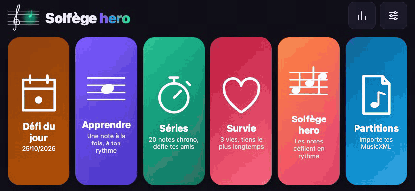
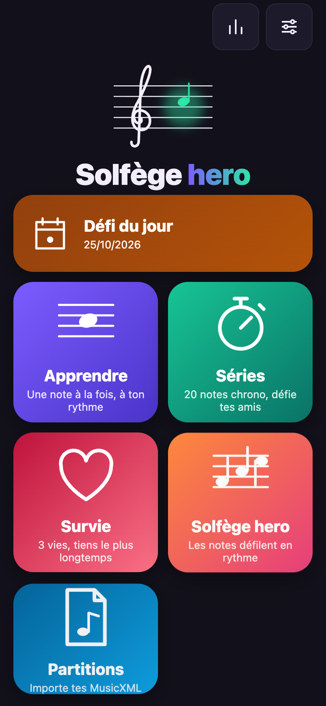

# Solfège hero

**Play now: <https://parriauxmaxime.github.io/solfege-hero/>** (free, no account, works offline once installed)

[](https://github.com/ParriauxMaxime/solfege-hero/actions/workflows/deploy.yml)
[](https://parriauxmaxime.github.io/solfege-hero/)



Solfège hero mode: notes scroll to a hit zone over a metronome ([MP4 version](docs/demo.mp4)).



A note-reading trainer for phones. Installable, works offline.

Languages: French and English (auto-detected, switchable in Settings).

- **Apprendre**: a note appears on the staff, tap its name as fast as you can.
- **Armures**: read a key signature, name the key.
- **Séries**: 20 notes against the clock, +5 s per mistake, share a challenge link.
- **Dictée**: 20 notes heard, not shown; find each one on the keyboard against the clock, share a challenge link.
- **Survie**: 3 lives, a few seconds per note, how far can you go.
- **Défi du jour**: the same 20 notes for everyone, once a day.
- **Solfège hero**: notes in real rhythms scroll toward a hit zone over a metronome; tap each one on the beat.
  Random bars or built-in tunes, with a tempo that adapts to how well you play.

Treble, bass and alto clefs, sharps and flats, adaptive practice that brings back the notes you miss, streaks and combos.

## Sharing

End screens offer **Partager** (the system share sheet, with the link passed separately so WhatsApp or Messages show a preview card) and **Copier le lien**. Challenge links point to the app's per-mode pages (`/challenge/`, `/survival/`, `/hero/`, `/daily/`, `/score/`, `/dictation/`), generated at build with their own Open Graph title and image; the app opens the challenge from the `#hash`. The old French paths (`/defi/`, `/survie/`, `/jour/`, `/partition/`, `/dictee/`) redirect there. Crawlers never see the hash, so the preview is generic for each challenge type, and the sender's time or score goes in the first line of the shared text. The preview images in `public/og/` are rendered by `npm run og`, and `npm run check:og` validates the tags.

## Install on a phone

1. Open the GitHub Pages URL of this repository in Chrome (or Safari on iOS).
2. Menu → **Install app** (or **Add to Home screen**).
3. Launch it from the home screen; portrait and landscape both work.

## Development

```sh
npm install
npm run dev        # http://localhost:5173, also served on the LAN
npm test
npm run typecheck
npm run build      # output in dist/
npm run preview    # serve the production build on port 4173
npm run icons      # regenerate the PNG icons from public/favicon.svg (needs Google Chrome)
npm run demo       # node scripts/demo.mjs, regenerate docs/demo.mp4, docs/demo.gif and docs/home.png
```

To regenerate the demo, run `npm run build && npm run preview` first, then `npm run demo` (needs Google Chrome and ffmpeg at `/opt/homebrew/bin/ffmpeg`).
The script drives the game through `window.__solfege`, which is only exposed with `?demo` in the URL (or in `npm run dev`).

On desktop, answer with the keys `c d e f g a b` or `1`–`7`, and `Shift` + letter for the sharp. Installing and offline support need a secure context,
so they only work on the GitHub Pages URL (or `localhost`), not over LAN HTTP.

## Deploy

Every push to `main` runs the tests, builds, and publishes `dist/` to GitHub Pages through
`.github/workflows/deploy.yml`. The repository's Pages source must be set to **GitHub Actions**
(Settings → Pages).

The site URL comes from `VITE_SITE_URL` (repository variable `SITE_URL`, default the github.io URL). It feeds canonical and Open Graph tags,
`sitemap.xml`, `robots.txt` and `humans.txt`, and a `CNAME` file is emitted when the host is not `github.io`. The app works at `/` and under a sub-path.

## Analytics

Set the repository variable `CF_BEACON_TOKEN` to inject the Cloudflare Web Analytics beacon in the app page (build env `VITE_CF_BEACON`).
It sets no cookies, so no consent banner is needed. For Google Search Console, verify the domain by DNS record: nothing to change in the code.
